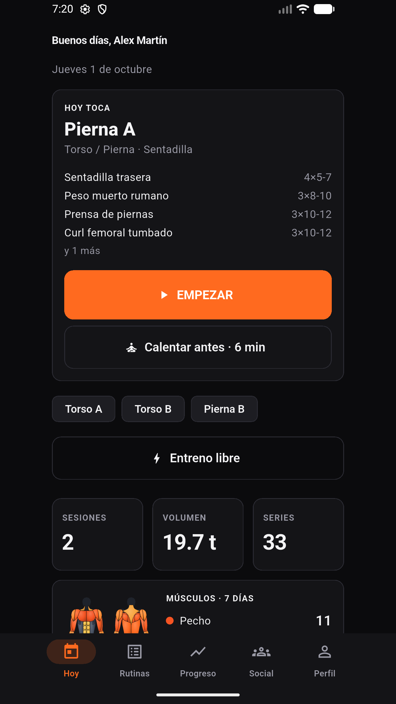
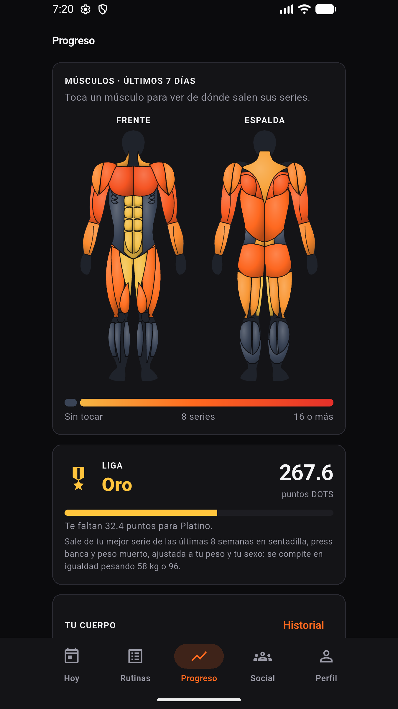
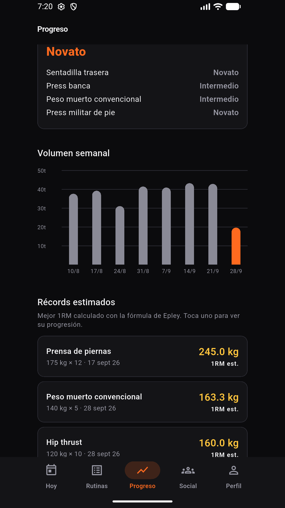
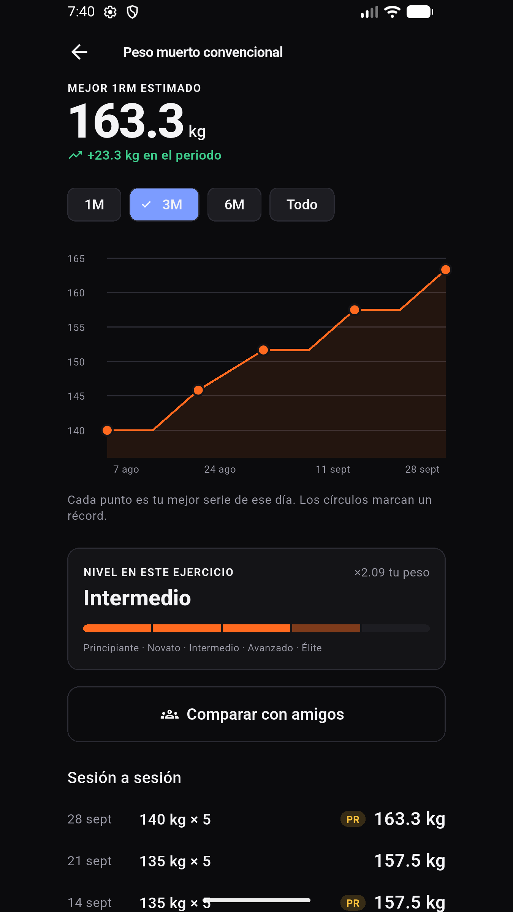
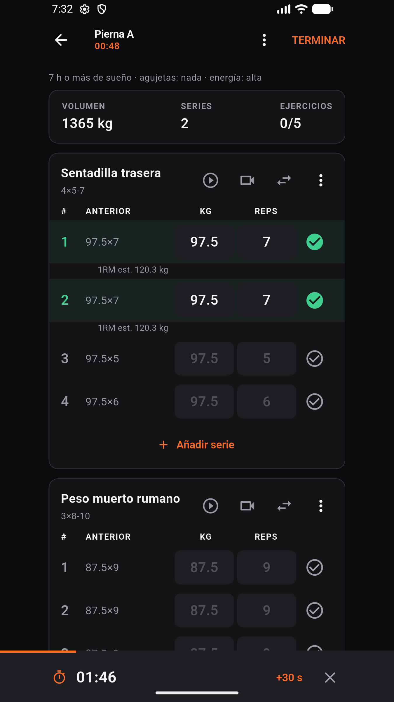
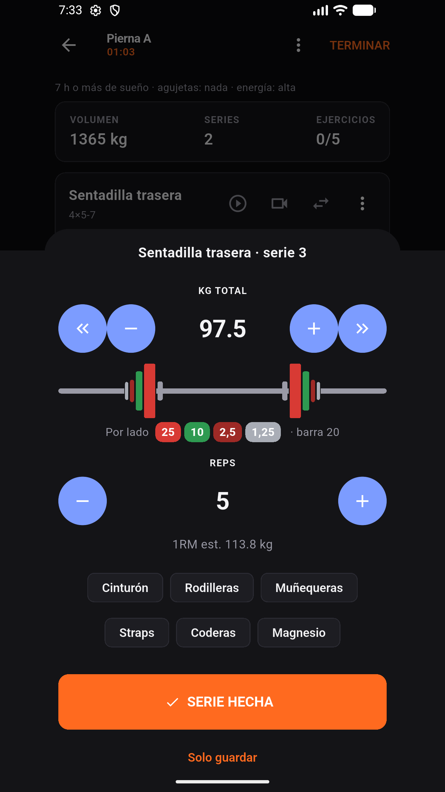

  

# Forja

> Strength-training log, coaching and community in one Flutter app, built to be used between sets.

**Forja** is a gym logbook designed for the real conditions of a training session: sweaty
hands, a phone glanced at between sets and no signal in the basement. Big numbers, big
buttons, `+`/`−` instead of tiny keyboards, and an offline-first core so nothing is ever lost.

🔗 **Google Play:** https://play.google.com/store/apps/details?id=dev.pauvh.forja

  
  
  
  
  
  

## What it does
- 🏋️ **Log a set with one thumb:** today's routine ready on screen, last session's numbers alongside, ↑ / = / ↓ per set, RPE/RIR, supersets, rest timer with lock-screen alerts.
- 🧮 **Plate calculator keypad:** draws the bar with the plates on each side, using your gym's equipment.
- 📥 **Import any routine:** from Excel, CSV or text pasted from WhatsApp (`Sentadilla 4x5 @8`), or generate one with AI or extract it from a YouTube video.
- 📈 **Progress:** estimated 1RM, PRs and charts per exercise, strength levels and leagues, weekly muscle map, plateau detection with the weight to try next.
- 📷 **On-device rep counter:** the camera counts reps and flags depth, rounded back or swinging, with pose detection running on the phone (video is never recorded or uploaded).
- 🧑‍🏫 **Coach mode:** coaches assign routines and follow their athletes' sessions and notes.
- 👥 **Social:** per-day rankings, challenges with photos and videos, reactions, comparing strength levels with friends.
- 💳 **Forja Pro:** subscription via Google Play Billing, verified server-side.

## Engineering highlights
**Offline-first for real, not "with a cache".** The app always reads and writes to local
SQLite (Drift). Every write also lands in an outbox, and a sync engine pushes it when there is
network. UUIDs are generated on the client, so a row is complete from birth and uploading it
twice never duplicates anything. → [`examples/flutter/sync`](./examples/flutter/sync)

**A finished workout can't be edited or deleted, enforced in the database.** Two independent
layers: a Postgres trigger rejects any update after completion, and RLS simply grants no
`DELETE` on workouts (what isn't granted is denied). → [`examples/supabase/workout_lock.sql`](./examples/supabase/workout_lock.sql)

**No API keys in the APK.** AI features run in Supabase Edge Functions; the Gemini key lives in
server secrets, with model fallback and structured output. → [`examples/supabase/functions`](./examples/supabase/functions)

**One formula, everywhere.** The 1RM estimate (Epley, adjusted for RPE/RIR) is implemented in
Dart for the live UI and as a generated column in Postgres for history, and both must match.
→ [`examples/flutter/formulas.dart`](./examples/flutter/formulas.dart)

## Tech stack
- **App:** Flutter · Dart · Riverpod · Drift (SQLite; WebAssembly on web) · fl_chart
- **Backend:** Supabase: PostgreSQL with Row Level Security, triggers and RPC, Auth, Storage, Edge Functions (Deno / TypeScript)
- **AI & ML:** Google Gemini (routine generation, video-to-routine, AI coach chat) · Google ML Kit pose detection (on-device)
- **Platform:** Google Play Billing with server-side purchase verification · Health Connect · local notifications · text-to-speech
- **Targets:** Android (Google Play, in production) · Web · Desktop

## In numbers
- ~66k lines of Dart across 160+ files, and 80+ test files
- 10 Edge Functions
- In production on Google Play, currently at version 1.24

## My role
Solo developer: product design, the Flutter app, the Supabase backend and security model, the
AI features, and publishing on Google Play.

## Code samples
The full source code is private. The [`examples/`](./examples) folder contains **real, unmodified
excerpts** of the production code, chosen to show the architecture and coding style. They are
not meant to compile on their own and contain no secrets. Code comments are in Spanish.

---
© Pau Viejo Herrero. All rights reserved.
